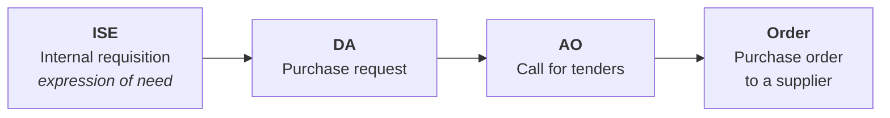
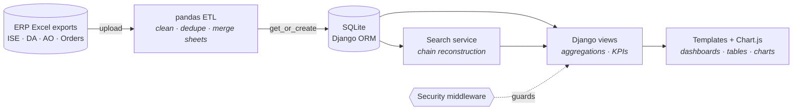
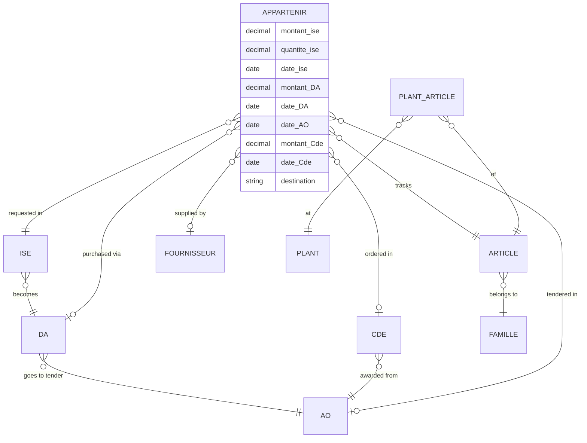

<p align="center">
  
</p>

<h1 align="center">SupplyTrack</h1>

<p align="center">
  <b>End-to-end traceability for industrial procurement: from the first request to the final purchase order.</b><br>
  Built for an industrial client (OCP) as an academic project at EMINES.
</p>

<p align="center">
  
  
  
  
  
</p>

---

## The problem

At a large industrial company, a single purchase goes through four separate stages, each with its own document, team and spreadsheet:



Each stage was tracked by hand through e-mails and Excel exports. Answering simple questions meant cross-referencing several files: *Where is my request? How long has it been stuck? Did we pay more than budgeted? Who are our main suppliers?*

**SupplyTrack** brings these exports into a single relational database and rebuilds the full chain for every article, so any request can be traced, timed and analyzed in seconds.

## Highlights

- **Full-chain traceability:** search by any identifier (ISE, DA, AO or order number) and see the whole chain it belongs to, article by article.
- **Automated Excel ingestion:** a pandas ETL pipeline cleans, deduplicates and links raw ERP exports, then logs every import with its status.
- **KPI dashboard:** live counts per stage and the most recent requests, each with a computed status (*Pending → In progress → Validated*).
- **Financial analytics:** stage-to-stage conversion rates, budget variance (requested vs ordered), supplier ranking and spend share, and breakdowns by plant, product family and article, all filterable by date.
- **Lead-time tracking:** processing time between each stage of an article's journey, along with a financial summary per stage.
- **Access control:** session-based authentication enforced across the app by custom middleware.

## Features

| Module | What it does |
|---|---|
| **Dashboard** | Document counts per stage (ISE / DA / AO / orders) and the 5 most recent requests with plant, amount and status |
| **Request tracking** | Search by document type and ID and get the full linked chain as a table |
| **Flow detail** | For one article: dates, quantities and amounts at each stage, financial recap, processing lead times |
| **Analytics** | Conversion funnel, spend per stage, ISE-vs-order budget variance, top 10 suppliers, plant, family and top-article breakdowns, Chart.js charts, date-range filter |
| **Data import** | Upload ISE, DA, AO and order Excel files. Rows are cleaned, linked and stored, with an import history (rows processed, errors, status) |
| **Settings & help** | User profile (auto-saved via a JSON API) and an in-app guide |

## Architecture



The app follows Django's **MVT** pattern:

- **Model:** the procurement entities and how they relate (see below).
- **View:** business logic, including ORM aggregations (`Sum`, `Count`, `Avg`, `F` expressions), conversion rates, budget variance and status computation.
- **Template:** a shared layout with reusable components, Chart.js visualizations and a custom template filter for French currency formatting (`200 100,33`).

### Data model



`Appartenir` is the core fact table. Each row follows **one article through every stage**, recording the amount, quantity and date at each step. That is what makes lead-time and budget-variance analysis possible.

## Data pipeline

Each Excel export has its own processor (`blog/DATAtraitement/`):

1. **Read and merge:** load the export sheets with pandas and join them on the document ID.
2. **Clean:** normalize text, parse decimals and dates, drop duplicates and placeholder values (`nan`, `N/A`, …).
3. **Link:** create or reuse entities (`get_or_create`) and attach each document to the previous stage (ISE → DA → AO → order), which rebuilds the full chain across files.
4. **Log:** record every import in `ImportHistory` with rows processed, error count and status (`SUCCESS` / `PARTIAL` / `ERROR`).

## Tech stack

| Layer | Tools |
|---|---|
| Backend | Python, Django 5.2 (MVT, ORM, custom middleware, context processors, template tags) |
| Data | pandas, openpyxl (Excel ETL), SQLite |
| Frontend | HTML, CSS, JavaScript, Chart.js |
| Deployment | Render-ready (`Procfile`) |

## Getting started

```bash
git clone https://github.com/Blink-emines/Supplytrack.git
cd Supplytrack
python -m venv venv && source venv/bin/activate    # Windows: venv\Scripts\activate
pip install -r requirements.txt

python manage.py migrate
python manage.py runserver
```

Open http://127.0.0.1:8000. Sign in with the credentials set in `config/settings.py` (`SECURITY_USER` / `SECURITY_PASSWORD`), then load data from the import panel (ISE → DA → AO → orders).

## Project structure

```
Supplytrack/
├── config/                 # Django project settings, URLs, WSGI/ASGI
├── blog/                   # main app
│   ├── models.py           # procurement data model
│   ├── views.py            # dashboard, tracking, analytics, import endpoints
│   ├── DATAtraitement/     # pandas ETL: ISE.py, DA.py, AO.py, CMD.py, search service
│   ├── templates/blog/     # dashboard, tracking, flow detail, analytics, settings, help
│   └── templatetags/       # currency formatting filter
├── security/               # login page and access-control middleware
├── templates/layout.html   # shared layout and navigation
└── static/                 # CSS and images
```

## My role

**Full-stack developer** in a team project, with a focus on the **frontend and data visualization**:

- Designed and built the user interfaces: dashboard, tracking, flow detail and analytics pages.
- Turned dense procurement data into clear KPIs, tables and Chart.js charts.
- Built smooth navigation between modules on top of a shared layout.
- Worked on the backend integration: views, aggregations and wiring the data pipeline to the UI.

## What I learned

1. **Turning a business process into a data model.** Mapping a real four-stage procurement workflow onto relational entities, and designing a fact table that follows each article from request to order.
2. **Working with messy real-world data.** ERP exports come with duplicates, inconsistent formats and missing links. A robust ETL has to clean them and tolerate partial data.
3. **Pushing work into the database.** Using Django ORM aggregations (`annotate`, `Sum`, `F` expressions) instead of Python loops to compute KPIs efficiently.
4. **Designing for decision-makers.** Choosing which numbers matter (conversion rates, budget variance, supplier concentration) and presenting them so they can be read at a glance.
5. **Working with a real client.** Gathering requirements from an industrial stakeholder and iterating on feedback across several versions.

## Roadmap

- Move secrets and credentials to environment variables, and use Django's built-in auth with roles
- PostgreSQL for production
- Automated tests for the ETL pipeline
- Export analytics to Excel and PDF
- Alerts for requests stuck at a stage beyond a time threshold

---

<p align="center">
  Built by <a href="https://github.com/Blink-emines">Blink-emines</a> · EMINES (School of Industrial Management, UM6P) × OCP
</p>
